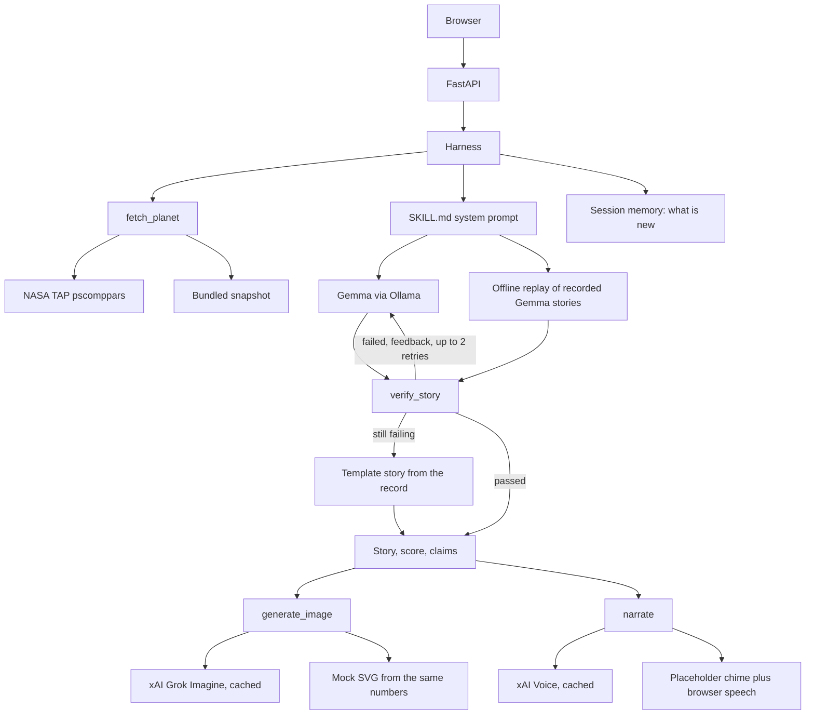
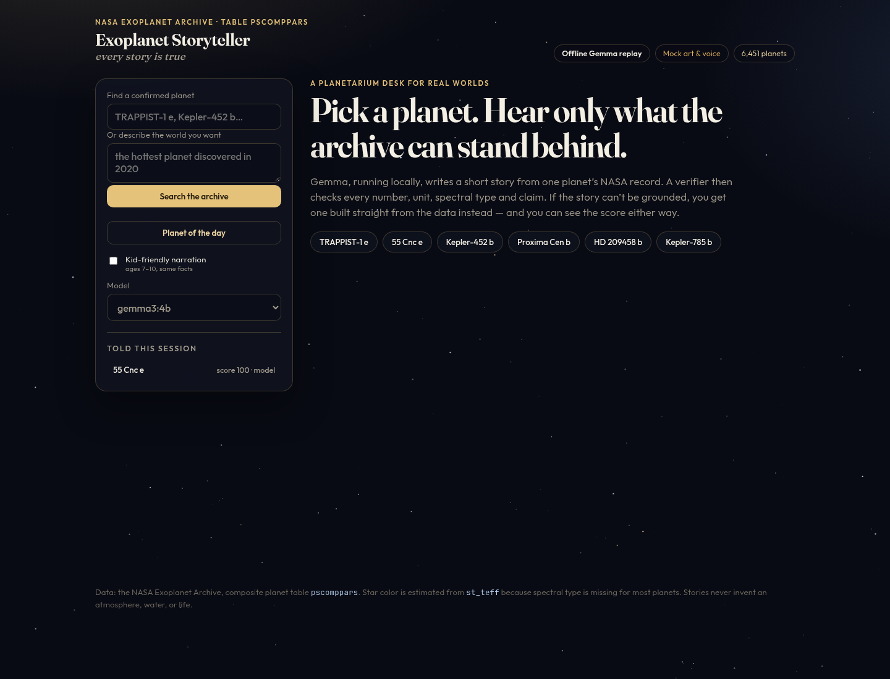
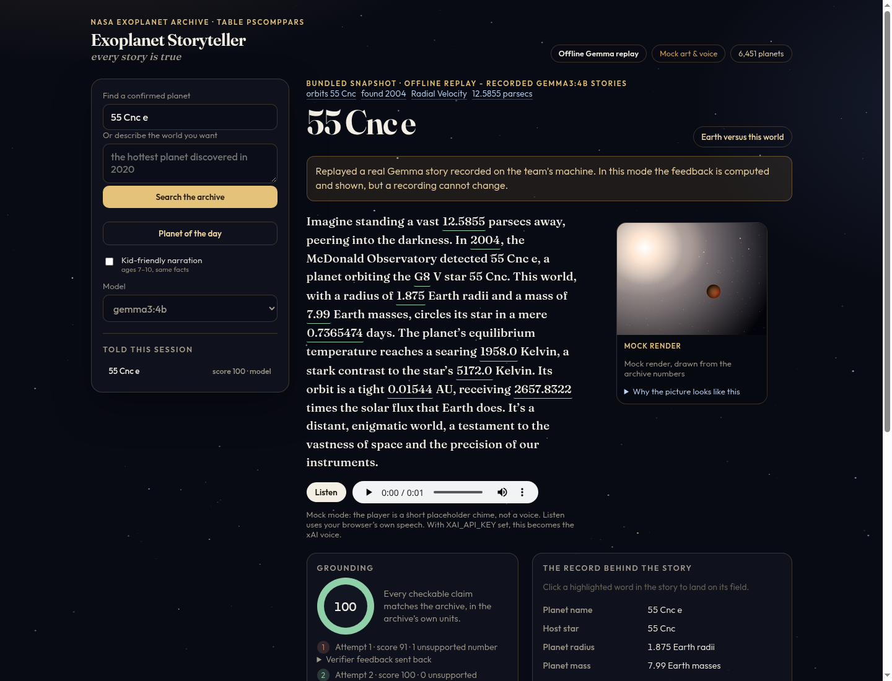
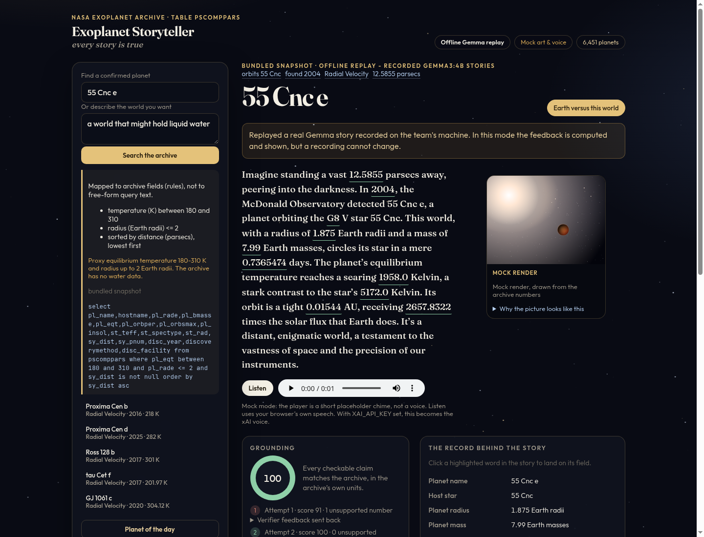

# Exoplanet Storyteller

**Every story is true.**

Pick any of the 6,451 confirmed exoplanets — or describe one, like “the hottest planet
discovered in 2020” — and the app writes a short, vivid story from that planet’s real
NASA record. Then it checks every number. You see the grounding score, claim by claim,
before you see the art or hear the narration.

A 4-person student project for MLH Hacktoberfest. Built in Cursor. The storyteller is
Gemma 3, running locally through Ollama. The pictures and the voice are xAI Grok Imagine
and the xAI Voice API, with a mock mode so the whole demo runs without a key.

## What you can do

- Search the catalog by name, with autocomplete, or ask in a sentence.
- Read a ~120 word story whose numbers are highlighted and linked to the archive field they came from.
- See the grounding score, the retry attempts, and the verifier’s feedback.
- Look at art whose color, scale, and mood come from the record (star temperature, planet radius, orbit, equilibrium temperature).
- Hear the story: the xAI voice when `XAI_API_KEY` is set, otherwise your browser’s own speech plus a labeled placeholder chime.
- Ask for the planet of the day, compare the world with Earth, and switch on a kid-friendly telling of the same facts.
- Within one session, hear what is new about this world compared with the ones already told.

## How a story gets told



The model is never allowed to write the archive query. A sentence becomes a `SearchIntent`
(a closed list of fields, operators, and discovery methods). Only `build_adql` turns that
into ADQL, and the same intent can run against the in-memory snapshot when TAP is down.
The archive applies `TOP` before `ORDER BY`, so a query like “the hottest” is ordered by
the service and then cut to the requested number of rows here. Putting `TOP` in the ADQL
returns the wrong planets.

## The three hackathon steps

**Model.** Google Gemma 3, open weights, local, through Ollama. Default `gemma3:4b`,
fast option `gemma3:1b`. Structured JSON output: `{story, numbers_used}`. If Ollama is
not running, the app says so and replays real Gemma stories recorded by the team
(`data/fixtures/gemma_stories.json`) instead of pretending to generate them.

**Skill.** `skills/exoplanet-story-grounding/SKILL.md` follows the Agent Skills spec:
`name` matches the folder, `description` is within 1–1024 characters, with `scripts/` and
`references/`. The harness does not keep its own copy of the prompt. `storyteller/skill.py`
reads the Role, Story rules, Kid-friendly mode, Output format, and Retry feedback sections
and sends them as the system prompt. The skill’s `verifier.py` is the checker the app runs.

**Harness.** `storyteller/` is written for this project, not wrapped around a framework.
Tools: `fetch_planet`, `search_planets`, `verify_story`, `generate_image`, `narrate`.
Session memory remembers planets already told and computes what is new (hottest so far,
shortest year, same star). The loop writes, verifies, sends the failing claims back, and
retries up to twice. After that it falls back to a template built only from the record,
which passes the verifier for every planet in the catalog. Each step is a JSON log line
in `logs/harness.jsonl`, with the API key redacted.

## Tracks

| Track | How this project meets it |
|---|---|
| SpaceXSI “Make it Legendary” | Real NASA Exoplanet Archive data in, a told and illustrated world out. Built in Cursor. Image prompts go to Grok Imagine and narration goes to the xAI Voice API when `XAI_API_KEY` is set. Both paths are implemented and cached. |
| Best Use of Gemma | Gemma 3 runs locally via Ollama and is the only writer. A strict prompt plus JSON output is what the app uses, because that is what measured well (below). `gemma3:1b` is the fast option in the model picker. |
| Best Open-Source AI Project | Gemma is open-weight. The skill, verifier, harness, and page are original and in this repo under Apache-2.0 for the skill. |

Grok Bot planning (a bonus on the SpaceXSI track, not a requirement) is not a separate
hosted Grok agent here. The planning is the local harness: the skill’s steps, the
validated query builder, and the retry loop.

## Measured grounding

From the team’s CPU runs: 6 planets, 3 seeds each, 18 stories per cell. The checker is
the unit-aware verifier in the skill. “Numeric pass” means no unsupported number.
“Strict + clean” also rejects unit conversions and qualitative claims the archive cannot
support (atmosphere, water, rocky, life, moons).

| model | prompt | stories | JSON ok | numeric pass | strict, no qualitative flags | unsupported numbers | mean time |
|---|---|---|---|---|---|---|---|
| gemma3:1b | basic | 18 | 18/18 (100%) | 7/18 (39%) | 1/18 (6%) | 11/127 (8.7%) | 5.0 s |
| gemma3:1b | strict + JSON | 18 | 13/18 (72%) | 16/18 (89%) | 4/18 (22%) | 2/149 (1.3%) | 9.4 s |
| gemma3:4b | basic | 18 | 18/18 (100%) | 10/18 (56%) | 2/18 (11%) | 10/155 (6.5%) | 11.7 s |
| gemma3:4b | strict + JSON | 18 | 17/18 (94%) | 17/18 (94%) | 14/18 (78%) | 1/185 (0.5%) | 25.3 s |

The app uses the strict JSON prompt. The failures that remain are why the retry loop and
the template exist: parsecs written as light-years, Celsius conversions, invented
qualitative claims, and number-word arithmetic (“sixteen” or “twenty-seven” for 163.8 or
2657). Host-star spectral type is missing for 4,041 of 6,451 planets (63%), so the star
is described from `st_teff` and a coarse color bin.

## Run it

```bash
# Gemma, once per machine
# https://ollama.com/download
ollama serve
ollama pull gemma3:4b          # the default. gemma3:1b is the fast option

# the app
python3 -m venv .venv
.venv/bin/pip install -r requirements.txt
cp .env.example .env           # put XAI_API_KEY in .env if you have one
make run                       # http://127.0.0.1:8741
```

`make test` runs the suite. It does not need Ollama, a network connection, or an API key.

Without Ollama, leave `LLM_BACKEND=auto`. The app notices Ollama is down and serves the
recorded Gemma stories, labeled as a replay. Without `XAI_API_KEY`, art is a data-drawn
SVG and the audio element is a short chime, both labeled as mock. The Listen button reads
the actual story with the browser’s speech synthesis.

Useful `.env` knobs (see `.env.example`):

| variable | purpose |
|---|---|
| `LLM_BACKEND` | `auto` (default), `ollama`, or `offline` |
| `OLLAMA_MODEL` | default `gemma3:4b` |
| `OLLAMA_FAST_MODEL` | `gemma3:1b`, shown in the model picker when it is pulled |
| `STORY_MAX_RETRIES` | extra attempts after the first, default 2 |
| `XAI_API_KEY` | server-side only. Leave empty for mock media |
| `APP_MOCK_MEDIA` | `auto`, `1`, or `0` |
| `ARCHIVE_OFFLINE` | `1` skips NASA and uses the bundled snapshot |

One planet from the command line: `python -m storyteller.cli "TRAPPIST-1 e"`.

## What it looks like

The desk, a checked story, and a request mapped onto archive fields. These are from offline replay with mock art.







## A three-minute demo

Do this with the app already open. Offline replay is enough for steps 1–3. Live Gemma is
the same screen, just slower (say so if a story is still writing).

1. **0:00 — the claim.** “Every number in the story is checked against the NASA Exoplanet Archive before you see it. The writer is Gemma, locally. The checker is ours.”
2. **0:20 — the retry.** Type `55 Cnc e` and press Enter. In the recorded `gemma3:4b` set, the first story scores 91 because Gemma wrote “twenty-seven times” for a flux of 2657. Open “Verifier feedback sent back”, then show attempt 2 at 100. Click `12.5855` in the story and land on the distance field.
3. **1:10 — the art.** Open “Why the picture looks like this.” Star color is the blackbody color of `st_teff`, size is `pl_rade`, mood is `pl_eqt`. If the badge says Mock render, say the prompt is the same one Grok Imagine receives when a key is set.
4. **1:30 — the voice.** Press Listen. With a key, press play on the audio element instead: that file is the xAI voice, generated once and cached.
5. **1:50 — language, not raw queries.** Ask for `the hottest planet discovered in 2020`. Read the mapped filters and the ADQL. Point out that the model never wrote that query. Open the top result.
6. **2:20 — Earth, and a child.** Toggle “Earth versus this world.” Then turn on kid-friendly and retell. Same record, shorter sentences, still checked.
7. **2:45 — memory.** Tell `TRAPPIST-1 e` after `55 Cnc e`. The line above the story says this one is the coldest and the longest year so far this session.

`Kepler-785 b` is the other recorded miss: the first `gemma3:4b` story invents a number, and a later seed is clean.

## Honest limitations

- The verifier catches numbers, units, spectral types, a list of discovery-method phrases, and a keyword list of physical claims. It will miss a poetic invention that uses none of those words, and a bare number with no unit can pass by matching some other field.
- It does not check that every unknown field is mentioned, only that a mentioned value is real.
- Gemma 4B with the strict prompt was numerically clean on 17 of 18 stories and fully clean on 14 of 18. The other four need the retry or the template. 1B still invents “rocky” and “habitable” often, which is why 4B is the default.
- On a CPU, 4B is about 10–30 seconds per attempt and a hard story can take three attempts. 1B is about 5–10 seconds and fails the qualitative check more often.
- Offline replay covers 6 planets and 3 seeds each, adult voice only. Any other planet, and every kid-mode story, becomes the template until Ollama is running. Replay cannot change a recording in response to feedback; the feedback is still computed and shown, and the next recorded seed is the next attempt.
- Mock art is a diagram drawn from the numbers, not a painting. Mock audio is a chime. Browser speech is the stand-in for the words. Neither has been compared with a live xAI response in this repo’s test run, because no key was available in that environment.
- Session memory lives in the server process. Restarting forgets who was told what.
- Star color is a coarse bin on `st_teff`, not a measured spectrum. The Earth column uses NASA reference values (black-body temperature 254 K, not the weather).
- The catalog snapshot bundled in `data/` is a point-in-time copy. With the network up, the app refreshes from TAP and fetches each planet live, and falls back to the snapshot if TAP fails.

## Tests

`make test` covers the verifier (the original planted errors, plus the temperature case the first checker missed, number-words, and a template pass for all 6,451 planets), query-builder injection, the retry loop with a fake model, the xAI clients with a fake HTTP transport (the image is downloaded without the API key), and the HTTP API on the offline replay.

## Layout

```
skills/exoplanet-story-grounding/   Agent Skill: prompt, verifier, template, field notes
storyteller/                        harness, FastAPI app, archive, media, memory
static/                             the page, no build
data/                               catalog snapshot and recorded Gemma stories
tests/                              pytest
```

Data source: the [NASA Exoplanet Archive](https://exoplanetarchive.ipac.caltech.edu/) TAP service, table `pscomppars`. No API key.
